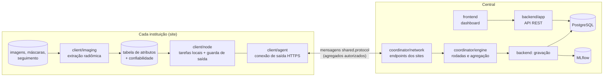
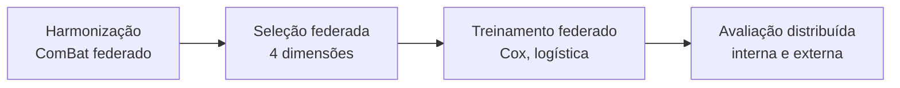

# Arquitetura do framework de radiômica federada

Visão consolidada das Etapas 1 a 8. Cada etapa tem um documento próprio com
detalhes, hipóteses e decisões (ver seção 12).

> **Estado.** Todo o framework foi verificado com dados sintéticos, dados
> simulados de estrutura plantada e fantomas de imagem. **Nenhuma análise com
> dados reais foi feita.** Nenhum número produzido até aqui tem significado
> científico.

## 1. Objetivo

Estimar a probabilidade individual de conversão de comprometimento cognitivo
leve (MCI) para doença de Alzheimer em 12, 24 e 36 meses, a partir de
atributos radiômicos de RM estrutural T1. O tempo até o evento e a censura à
direita são considerados em todas as etapas.

Os dados ficam em cada instituição. Só estatísticas agregadas autorizadas
circulam.

## 2. Componentes

| Pacote | Responsabilidade | Depende de |
|---|---|---|
| `shared/` | protocolo de mensagens, configurações versionadas, regras de divulgação, otimizador de Newton, formatos de modelo | — |
| `client/` | dados locais, extração radiômica, confiabilidade, seleção e modelos locais, tarefas federadas, guarda de saída, agente do site | `shared`, `evaluation`, `harmonization` |
| `coordinator/` | registro, rodadas, validação de entrada, agregação, seleção/treinamento/avaliação/harmonização federados, endpoints de rede, proveniência | `shared`, `evaluation`, `harmonization` |
| `evaluation/` | convenções de censura e métricas a partir de somas aditivas | `shared` |
| `harmonization/` | ComBat e avaliação de efeitos de site | `shared` |
| `backend/` | API REST, persistência (migrações), MLflow, relatórios, lançadores | `shared`, `coordinator` |
| `experiments/` | configurações, simulação, execução distribuída, reprodução, estudo de custos | todos |
| `frontend/` | dashboard (React); só consome a API | — |
| `infrastructure/` | imagens Docker, Compose, demonstração distribuída | — |

Regras verificadas por teste sobre os imports (`tests/federated/test_architecture.py`):
- o backend não contém código científico;
- coordenador, avaliação e harmonização usam só NumPy;
- bibliotecas de imagem só no cliente;
- servidor HTTP só em `coordinator/network/`, e cliente HTTP só no agente do
  site.

## 3. Fluxo de um experimento

- Cada fase é opcional e configurada na mesma configuração versionada
  (`shared/config.py`, identificada por hash).
- Cada site separa localmente uma partição de teste que a harmonização, a
  seleção e o treinamento nunca veem.
- Todas as fases trocam **rodadas**: o coordenador envia uma configuração de
  rodada a todos os sites; cada site responde com estatísticas agregadas da
  sua partição.

| Fase | Rodadas | Agregação (sem média de parâmetros) |
|---|---|---|
| Harmonização | estatísticas de regressão → variância → aplicação local | d-ComBat: regressão e variância combinadas; ajuste de Bayes empírico de cada site feito no próprio site |
| Seleção | inventário → confiabilidade → relevância (U, I de Cox) → covariância dos candidatos | Cox estratificado por site, I², correlação intra-site; estratégias comparadas sem comunicação extra |
| Treinamento | padronização → iterações de Newton → risco basal/intercepto por site | soma exata de log-verossimilhança, gradiente e informação de cada site |
| Avaliação | uma rodada por modelo e variante | soma de estatísticas suficientes; AUC e C estratificados por site |

**Equivalências verificadas por teste**: cada resultado federado é idêntico
ao cálculo centralizado correspondente (Cox estratificado por site,
logísticas, ComBat, métricas estratificadas), e a execução distribuída por HTTP
é idêntica à simulação.

## 4. Protocolo (versão 1.4)

Mensagens JSON com esquema fechado: campo desconhecido é rejeitado e não há
texto livre. Os vetores são indexados por atributo, nunca por participante.
Cada mensagem tem no máximo 1 MiB.

| Tarefa | O que o site envia | Regras de divulgação |
|---|---|---|
| `feature_inventory` | nomes dos atributos | — |
| `feature_summary` | n, média, variância por atributo | coorte ≥ `min_cohort_size` |
| `feature_reliability` | resumo de confiabilidade por atributo | estudo com ≥ `min_cohort_size`; sem estudo, recusa |
| `feature_relevance` | U e I do escore de Cox por atributo | eventos ≥ `min_events` |
| `feature_covariance` | matriz de dispersão intra-site dos candidatos (≤ 200) | coorte ≥ `min_cohort_size` |
| `model_update` | log-verossimilhança, gradiente, informação no β global | eventos (e não conversores conhecidos) ≥ `min_events` |
| `baseline_hazard` / `site_intercept` | risco basal ou intercepto do site nos horizontes | eventos ≥ `min_events` |
| `harmonization_*` | somas da regressão do ComBat; resíduos; somas após ajuste; seguimento mediano **arredondado** | coorte ≥ `min_cohort_size` |
| `model_evaluation` | somas para Brier, AUC, C, calibração e curva de decisão | eventos ≥ `min_events`; faixas de calibração pequenas fundidas no site |

Coordenador → site: registro, configuração de rodada (com parâmetros
**globais**: β, padronização, ComBat global) e fim de sessão.

## 5. Modelo de privacidade

| Quem | Vê |
|---|---|
| Site | só os próprios dados; recebe apenas parâmetros globais |
| Coordenador | estatísticas agregadas de cada site, durante o experimento, em memória |
| Banco, API, MLflow, dashboard | apenas resultados globais; métricas e perfil por site só quando o experimento os libera |

Proteções, cada uma com teste:
- esquema fechado e vetores indexados por atributo;
- verificação na saída do site e de novo na entrada do coordenador;
- busca, na mensagem de saída, dos identificadores locais dos participantes;
- coorte mínima e número mínimo de eventos;
- nenhum agregado liberado com menos de dois sites;
- faixas de calibração pequenas fundidas;
- seguimento mediano arredondado para meses;
- escores calculados sem cada site nunca liberados;
- estatísticas por site nunca gravadas.

Os testes de isolamento capturam todos os bytes trocados e verificam que
nenhum identificador nem valor individual (atributo, tempo, predição) aparece
na rede. Mutações que liberariam estatísticas de um site são detectadas.

**Limites assumidos**: coordenador honesto-mas-curioso; não há agregação
segura nem privacidade diferencial; com poucos sites, agregados restringem os
valores possíveis por site; as várias iterações de Newton revelam gradientes
por site ao coordenador.

## 6. Modos de execução

| Modo | Para quê | Como |
|---|---|---|
| Simulação em processo | desenvolvimento, testes | `python -m experiments.run_simulation --config ...` |
| Federação local por HTTP | testar o modo distribuído numa máquina | `experiments.local_federation.run_over_http` |
| Pilha local (Docker) | API, banco, MLflow, dashboard | `docker compose -f infrastructure/docker-compose.yml up --build` |
| Demonstração distribuída (Docker) | coordenador + 3 sites isolados | `infrastructure/distributed/demo.sh` |
| Implantação entre instituições | uso real | ver `etapa-8.md`, guia de implantação |

## 7. Reprodutibilidade

- **Dependências**: versões exatas em `uv.lock` e `frontend/package-lock.json`;
  o PyRadiomics é fixado por commit.
- **Configurações**: versionadas, validadas e identificadas por hash; sementes
  derivadas deterministicamente.
- **Esquema do banco**: versionado por migrações Alembic.
- **Registro de cada execução**: impressão digital (SHA-256) dos resultados
  liberados e proveniência do código (commit, hash do `uv.lock`, versões das
  bibliotecas), no banco e no MLflow.
- **Verificação**: `python -m experiments.reproduce` reexecuta e compara. A
  mesma configuração dá a mesma impressão digital em simulação e em modo
  distribuído (testado). A garantia vale no mesmo ambiente; entre plataformas,
  diferenças de arredondamento podem mudar a impressão.

## 8. Custos

Resultados em [custos.md](custos.md), gerados por
`python -m experiments.benchmark_costs`:
- cerca de 39 rodadas no pipeline completo, quase independentes do número de
  sites, atributos e participantes;
- tráfego linear no número de sites e da ordem de centenas de KB;
- maior mensagem de poucos KB;
- ~25 ms de sobrecarga de transporte por rodada na rede local.

## 9. Qualidade

| Item | Situação |
|---|---|
| Backend | 260 testes, `ruff` |
| Frontend | 16 testes, TypeScript estrito |
| Integração contínua | GitHub Actions (`.github/workflows/ci.yml`): testes, dashboard, imagens |

Formas de verificação usadas:
- respostas conhecidas da literatura (Shrout & Fleiss, teste de log-rank,
  incidência de Kaplan–Meier);
- bibliotecas de referência (scikit-survival, scikit-learn, neuroCombat);
- equivalência entre federado e centralizado;
- estrutura plantada em dados sintéticos;
- testes de mutação;
- varreduras de isolamento;
- execução real em PostgreSQL, Docker e navegador.

## 10. Registro de decisões

Decisões tomadas durante o desenvolvimento, em vigor e abertas a revisão. As
etapas foram aprovadas, mas estes pontos não foram discutidos um a um.

| # | Decisão | Etapa | Onde mudar |
|---|---|---|---|
| 1 | Coordenador honesto-mas-curioso; sem agregação segura nem privacidade diferencial | 1, 4, 5 | `shared/privacy.py`, protocolos |
| 2 | Limiares de divulgação: coorte ≥ 10, eventos ≥ 5, ≥ 2 sites por agregado | 1, 4 | `privacy` na configuração |
| 3 | Transporte próprio por HTTP com sites conectando para fora, em vez de Flower | 1, 8 | `coordinator/network` |
| 4 | Parâmetros de extração copiados do protocolo OASIS-3 existente | 2 | `experiments/configs/extraction/` |
| 5 | Confiabilidade por perturbações controladas enquanto não houver reteste/segunda segmentação | 3 | `experiments/configs/reliability/` |
| 6 | Seleção por etapas (filtros) como padrão; ponderação só para comparação | 3, 4 | estratégias da configuração |
| 7 | Atributo constante em um site é excluído em todos | 4 | `coordinator/selection` |
| 8 | Risco basal e intercepto liberados como média dos sites ponderada pelo tamanho | 5 | `coordinator/training` |
| 9 | Logística com intercepto por site recomendada | 5 | configurações de treinamento |
| 10 | Partição de teste de 30% por site, estratificada pelo evento | 5 | `data_split` |
| 11 | Discriminação agregada estratificada por site | 6 | `evaluation/metrics.py` |
| 12 | ComBat antes da seleção, preservando `clin_age`; validação externa sem refazer a harmonização | 6 | `harmonization` na configuração |
| 13 | Métricas por site liberadas nos exemplos | 6 | `release_site_metrics` |
| 14 | Token único na API; um token por site no coordenador | 7, 8 | `FEDRAD_API_TOKEN`, `sites.yaml` |
| 15 | Banco sem histórico de migração é recusado | 7 | `backend/app/migrations.py` |

## 11. Limitações e próximos passos

Para analisar dados reais ainda faltam:
1. converter os dados OASIS-3 (`.mgz`, tabelas clínicas) para NIfTI e
   manifesto;
2. **definir, com a equipe clínica, o evento de conversão MCI → DA e o tempo de
   seguimento**: data de referência, critério diagnóstico, tratamento de
   reversões;
3. obter observações repetidas ou segmentações alternativas para a
   confiabilidade;
4. intervalos de confiança das métricas (bootstrap local por site, combinado);
5. revisão de privacidade por um comitê de proteção de dados antes de qualquer
   implantação entre instituições (agregação segura, se exigida);
6. autenticação institucional de usuários no dashboard.

## 12. Documentos

| Documento | Conteúdo |
|---|---|
| [etapa-1.md](etapa-1.md) | arquitetura, contratos, isolamento |
| [etapa-2.md](etapa-2.md) | pipeline radiômico local |
| [etapa-3.md](etapa-3.md) | confiabilidade, relevância, redundância, seleção local |
| [etapa-4.md](etapa-4.md) | seleção federada |
| [etapa-5.md](etapa-5.md) | modelos prognósticos locais e federados |
| [etapa-6.md](etapa-6.md) | harmonização e avaliação |
| [etapa-7.md](etapa-7.md) | API consolidada e dashboard |
| [etapa-8.md](etapa-8.md) | implantação distribuída, reprodutibilidade, custos, CI |
| [custos.md](custos.md) | estudo de custos (gerado) |
