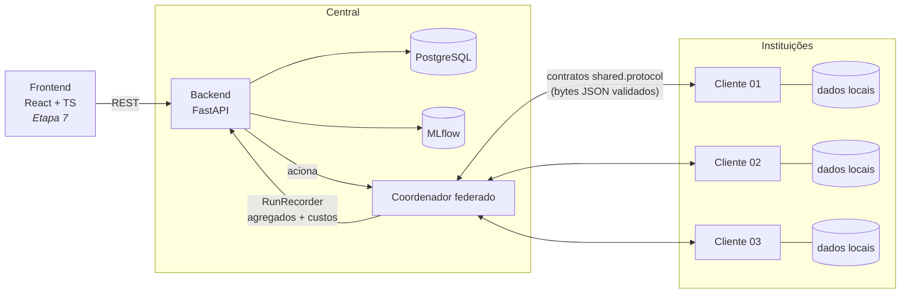
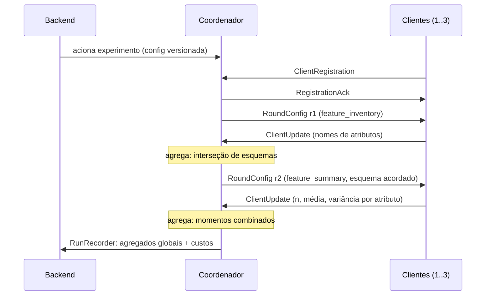

# Etapa 1 — Arquitetura e infraestrutura do framework federado

Estado: **implementada, aguardando revisão**. Nenhum módulo científico (extração
radiômica, confiabilidade, seleção, harmonização, modelagem, avaliação) foi
implementado; só existem as suas interfaces.

> Os dados usados nesta etapa são **sintéticos** (ruído aleatório) e servem
> apenas para testar infraestrutura e comunicação. Todo resultado derivado
> deles é marcado com `data_origin = synthetic` no protocolo, no banco, na API
> e no MLflow, e não tem significado científico.

## 1. Visão geral



Não existe rota cliente↔cliente. A única coisa que atravessa a fronteira
cliente/coordenador são mensagens dos modelos definidos em `shared/protocol.py`.

## 2. Responsabilidade de cada componente

| Componente | Pacote | Responsabilidade | Não faz |
|---|---|---|---|
| Contratos | `shared/` | Mensagens do protocolo, configuração versionada, regras de divulgação, sementes, custos, logging | Importar qualquer outro componente |
| Cliente | `client/` | Carregar dados locais, executar tarefas locais, autorizar e serializar o que sai (`EgressGuard`) | Conhecer o coordenador, o backend ou outros clientes |
| Coordenador | `coordinator/` | Admitir clientes, distribuir configurações, validar o que chega (`ingress`), agregar, medir custos, reportar via `RunRecorder` | Persistir, importar `client` ou `backend`, reter atualizações individuais após agregar |
| Backend | `backend/` | API REST, persistência, rastreamento MLflow, acionamento das execuções | Algoritmos científicos, importar `client` |
| Avaliação | `evaluation/` | Métricas e comparações (Etapa 6) — só interface | — |
| Experimentos | `experiments/` | Raiz de composição: simulação em uma máquina, configs reprodutíveis, CLI | — |
| Frontend | `frontend/` | Dashboard (Etapa 7) — só o diretório | Processamento científico |
| Infraestrutura | `infrastructure/` | Dockerfiles e Docker Compose | — |

As regras de dependência são verificadas por teste sobre o grafo de imports
(`tests/federated/test_architecture.py`):

```
shared      -> (nada)
client      -> shared
coordinator -> shared
evaluation  -> shared
backend     -> shared, coordinator
experiments -> todos
```

No coordenador, as três fases científicas ficam em subpacotes separados, cada
uma com a sua interface de estratégia: `coordinator/selection`
(`FeatureSelectionStrategy`), `coordinator/training` (`TrainingStrategy`) e
`coordinator/evaluation` (`EvaluationStrategy`). FedAvg não é assumido em lugar
nenhum: a agregação é escolhida por nome na configuração
(`coordinator/aggregation.py`).

## 3. Contratos de comunicação cliente ↔ coordenador

Versão do protocolo: `1.0` na Etapa 1; `1.1` na Etapa 4, `1.2` na Etapa 5 e `1.3` a partir da Etapa 6 (ver `etapa-4.md` a `etapa-6.md`). Formato: JSON UTF-8, no máximo 1 MiB por mensagem.
Todos os modelos são imutáveis e **fechados** (`extra="forbid"`).

| Mensagem | Direção | Conteúdo |
|---|---|---|
| `ClientRegistration` | cliente → coord. | `client_id` pseudonimizado, versão do protocolo, experimento, tarefas suportadas, `data_origin`, versões de bibliotecas |
| `RegistrationAck` | coord. → cliente | aceito / código de recusa |
| `RoundConfig` | coord. → cliente | rodada, fase, tarefa, semente, hash da configuração, política de privacidade, esquema de atributos acordado, parâmetros |
| `ClientUpdate` | cliente → coord. | status, código de motivo, **payload autorizado**, custos locais |

Payloads autorizados na Etapa 1 (união discriminada por `kind`; novas etapas
adicionam novos tipos explicitamente):

- `feature_inventory`: nomes dos atributos disponíveis no site (sem valores).
- `feature_summary`: por atributo, `n`, média e variância amostral.

Sequência do fluxo mínimo:



### Regras de isolamento

1. **Lista de permissão por esquema.** Campo desconhecido é rejeitado; não há
   campo de texto livre (motivos são códigos de um enum; strings têm padrão).
2. **Vetores indexados por atributo.** Todo vetor de um payload tem exatamente
   `len(feature_names)` posições; não há como expressar um vetor por participante.
3. **Coorte mínima.** O cliente recusa reportar estatísticas com menos de
   `min_cohort_size` participantes (padrão 10).
4. **Agregado mínimo.** O coordenador não libera agregado com menos de
   `min_clients_per_aggregate` sites válidos (padrão 2) — um "agregado" de um
   site seria a estatística desse site.
5. **Defesa em profundidade.** As mesmas regras rodam na saída do cliente
   (`client/egress.py`, que também procura identificadores locais nos bytes) e
   na entrada do coordenador (`coordinator/ingress.py`).
6. **Sem retenção.** O coordenador descarta as atualizações individuais após
   agregar; o backend recebe e grava apenas agregados globais, metadados
   (status, tamanho da coorte) e custos. Exceção da Etapa 4: na seleção
   federada, as estatísticas por site ficam em memória até o fim da seleção
   (ver `etapa-4.md`); continuam sem ser gravadas ou liberadas.

### Hipóteses e limitações

- Modelo de ameaça: coordenador honesto-mas-curioso e clientes honestos. As
  verificações evitam divulgação **acidental** pelo nosso próprio código; não
  protegem contra uma implementação maliciosa de cliente.
- O coordenador vê agregados por site. Agregação segura e privacidade
  diferencial não estão implementadas.
- Checagem de formato não prova que um vetor de tamanho `n_atributos` não
  codifica valores individuais; isso depende da revisão das tarefas locais
  (`client/tasks.py`), único ponto que produz payloads.
- Coorte mínima é condição necessária, não suficiente (consultas repetidas e
  coortes pequenas ainda vazam informação por agregados).
- O tamanho da coorte de cada site (`n_samples`) é enviado e armazenado.
- Na simulação todos os clientes compartilham um processo: o pico de memória
  por cliente é um limite superior e o tempo de comunicação é só o custo de
  serialização.

## 4. Estrutura de diretórios

```
shared/            contratos e utilitários comuns
  protocol.py        mensagens do protocolo (única superfície de comunicação)
  privacy.py         regras de divulgação (egresso e ingresso)
  config.py          configuração de experimento (YAML -> Pydantic) + hash
  costs.py seeding.py logging.py
client/
  data.py            LocalDataset / LocalDataSource (nunca sai do cliente)
  synthetic.py       fonte sintética (apenas infraestrutura)
  tasks.py           tarefas locais -> payloads autorizados
  egress.py          guarda de saída
  node.py            nó do cliente (bytes entram, bytes saem)
  interfaces.py      contratos provisórios das Etapas 2-5
coordinator/
  engine.py          registro + orquestração das rodadas
  registry.py ingress.py aggregation.py transport.py outcomes.py ports.py
  selection/ training/ evaluation/   interfaces das três fases
backend/app/
  main.py settings.py db.py models.py schemas.py tracking.py deps.py
  routers/           experiments, clients, federated_rounds, models, results
  services/          experiments, recording (RunRecorder), launchers
evaluation/        interfaces de métricas (Etapa 6)
experiments/
  simulation.py      composição cliente + coordenador
  run_simulation.py  CLI
  configs/stage1_simulation.yaml
frontend/          reservado (Etapa 7)
infrastructure/    docker-compose.yml, docker/, postgres/
tests/federated/   contratos, isolamento, agregação, fluxo, backend, arquitetura
```

O pipeline OASIS-3 já existente (`dataset /`, `oasis_analysis/`, `tests/test_*.py`,
`requirements.txt`) não foi alterado.

## 5. Dependências

Declaradas em `pyproject.toml` (grupos opcionais) e congeladas em `uv.lock`.

| Grupo | Pacote | Função |
|---|---|---|
| núcleo | pydantic | contratos e validação de configuração |
| núcleo | PyYAML | configurações versionadas |
| núcleo | numpy (`<2`) | estatísticas locais e agregação; `<2` por causa do PyRadiomics 3.0.1 |
| núcleo | structlog | logging estruturado (JSON) |
| backend | fastapi, uvicorn | API REST |
| backend | SQLAlchemy, psycopg | persistência em PostgreSQL |
| backend | pydantic-settings | configuração por variáveis de ambiente |
| backend | mlflow-skinny, alembic | cliente de rastreamento MLflow (alembic é exigido pelo store SQL do MLflow) |
| science *(não instalado na Etapa 1)* | SimpleITK, pandas, scipy, scikit-learn, scikit-survival; PyRadiomics e PyTorch entram nas etapas que os usam | pipeline radiômico e modelagem |
| flower *(não instalado)* | flwr | adaptador de transporte, se compatível |
| dev | pytest, httpx, ruff | testes e lint |

## 6. API do backend (Etapa 1)

| Método | Rota | Função |
|---|---|---|
| POST | `/experiments` | cria experimento a partir de uma configuração validada |
| GET | `/experiments`, `/experiments/{id}` | lista / detalha |
| POST | `/experiments/{id}/run` | aciona a execução (assíncrona; 409 se já executado) |
| GET | `/clients?experiment_id=` | sites pseudonimizados e status de registro |
| GET | `/federated-rounds?experiment_id=`, `/federated-rounds/{id}` | rodadas e participação |
| GET | `/models?experiment_id=` | versões de modelos (vazio até a Etapa 5) |
| GET | `/results/{id}`, `/results/{id}/costs` | agregados globais e custos |
| GET | `/health` | verificação de saúde |

## 7. Decisões que pedem revisão

1. **Flower não é usado na Etapa 1.** O coordenador fala com os clientes por
   uma interface de bytes (`ClientEndpoint`), com um transporte em processo que
   serializa tudo. O protocolo desta etapa (inventário de esquema, estatísticas
   suficientes) não é do tipo "ajuste de parâmetros" do Flower. Proposta:
   avaliar um adaptador Flower na Etapa 4/5, onde houver compatibilidade.
2. **Pacote `shared/`** foi acrescentado à lista de diretórios pedida, para
   que cliente e coordenador compartilhem contratos sem depender um do outro.
3. **Limiares de privacidade** (`min_cohort_size = 10`,
   `min_clients_per_aggregate = 2`) são padrões de configuração, não valores
   justificados; devem ser definidos pelo protocolo do estudo.
4. **Quem inicia a comunicação.** Hoje o coordenador chama os clientes. Entre
   instituições reais, o usual é o cliente iniciar a conexão (firewalls); isso
   muda o transporte, não os contratos.
5. **Acionamento.** O backend dispara a simulação como subprocesso. Na
   implantação distribuída o coordenador vira um serviço próprio.
6. **Esquema do banco** é criado com `create_all`; migrações Alembic ficam
   para a Etapa 7.
7. **Sem autenticação** na API e no registro de clientes (lista de permissão
   por identificador apenas). Necessária antes de qualquer uso distribuído.
8. **Convivência com o pipeline existente.** O framework usa Python 3.12 e
   ambiente próprio (`uv`); o pipeline OASIS-3 mantém `requirements.txt`. Os
   testes antigos em `tests/` exigem o ambiente antigo.

## 8. Como executar

```bash
uv sync --extra backend --extra dev --extra imaging --extra science
```

```bash
uv run pytest tests/federated
```

```bash
uv run python -m experiments.run_simulation --config experiments/configs/stage1_simulation.yaml
```

```bash
uv run uvicorn backend.app.main:app_factory --factory --port 8000
```

Sem variáveis de ambiente, o backend usa SQLite e MLflow locais em `var/`.
Para PostgreSQL + servidor MLflow, use `infrastructure/docker-compose.yml`.
