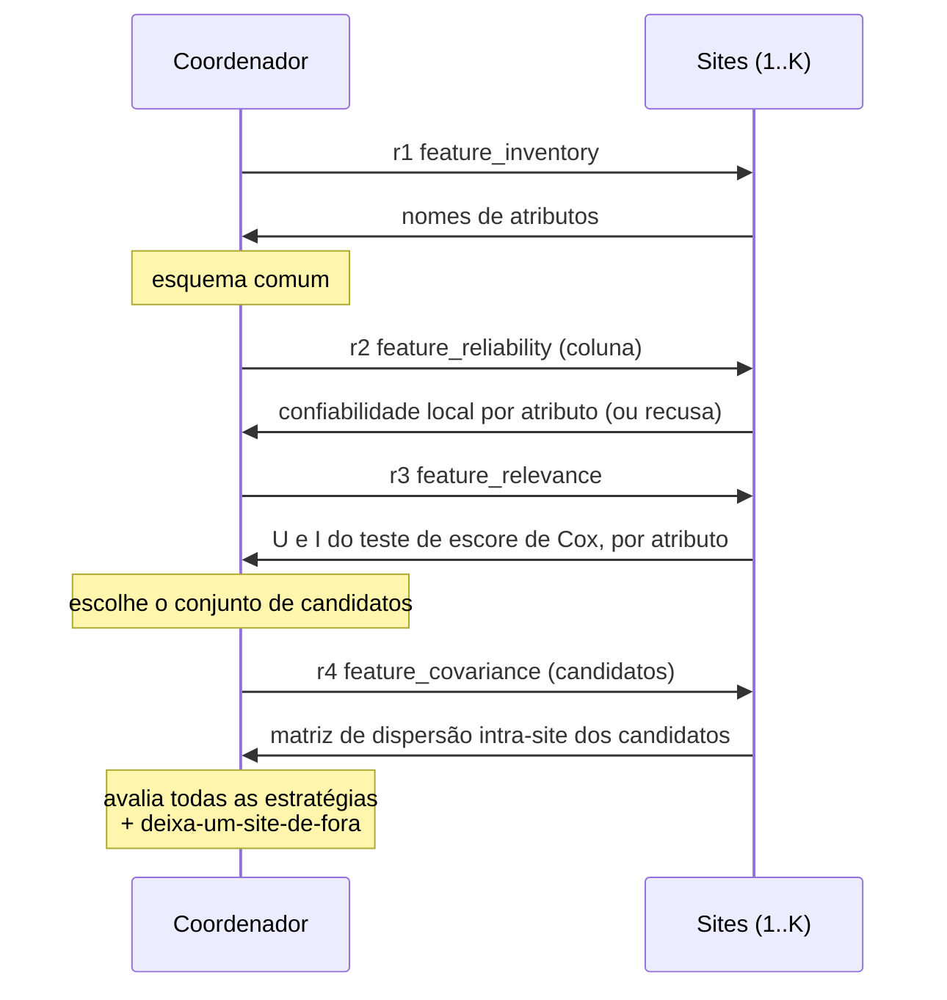

# Etapa 4 — Seleção federada de atributos

Estado: **implementada, aguardando revisão**. Treinamento federado, avaliação
distribuída e harmonização continuam sem implementação.

> Verificada com respostas conhecidas, com a equivalência exata entre cálculo
> federado e centralizado, e com sites sintéticos de estrutura plantada. **Nada
> foi executado sobre dados reais**; estratégias, limiares e pesos da
> configuração de exemplo são exemplos para comparar, não escolhas.

## 1. Visão geral

Uma execução federada coleta **uma vez** as estatísticas por site das quatro
dimensões. Em seguida, todas as estratégias configuradas são avaliadas no
coordenador sobre essas mesmas estatísticas. Comparar métodos de agregação ou
pesos, portanto, não custa comunicação adicional.



- **r1** é omitida quando uma rodada fixa anterior já acordou o esquema.
- **r2** é omitida quando nenhuma estratégia usa confiabilidade.
- **r4** é omitida quando nenhuma estratégia poda redundância.

| Módulo | Função |
|---|---|
| `shared/protocol.py` | Novas tarefas, payloads e agregados (protocolo `1.1`) |
| `shared/selection.py` | Configuração versionada da seleção federada |
| `client/tasks.py` | Tarefas locais `feature_reliability`, `feature_relevance`, `feature_covariance` |
| `coordinator/selection/statistics.py` | Estatísticas federadas de cada dimensão (só NumPy) |
| `coordinator/selection/strategies.py` | Estratégias globais sobre as estatísticas combinadas |
| `coordinator/selection/protocol.py` | Planejamento das rodadas, agregação, comparação, estabilidade |
| `coordinator/selection/results.py` | O que é liberado |
| `backend/` | Tabelas `feature_selections` e `selected_features`; rotas `/results/{id}/feature-selection` e `/results/{id}/selected-features` |

## 2. Contratos novos

| Payload | Conteúdo por site | Regra de divulgação |
|---|---|---|
| `feature_reliability` | coluna (`min_icc` ou `min_ci_low`), tamanho do estudo de confiabilidade, um valor por atributo (ou nulo) | estudo com pelo menos `min_cohort_size` participantes |
| `feature_relevance` | n, número de eventos, escore U e informação I por atributo | coorte ≥ `min_cohort_size` **e eventos ≥ `min_events`** |
| `feature_covariance` | n, se houve transformação em postos, triângulo superior da matriz de dispersão intra-site dos candidatos (p(p+1)/2 valores, p ≤ 200) | coorte ≥ `min_cohort_size` |

`min_events` é regra nova da política de privacidade (padrão 5): com um só
evento, o escore U de um atributo é o valor daquele participante menos a
média do conjunto de risco. Como os demais limiares, é heurístico e deve ser
fixado pelo protocolo do estudo.

Os payloads seguem as regras da Etapa 1: esquema fechado, vetores indexados
por atributo (a matriz de dispersão é indexada por par de atributos), checagem
na saída do cliente e de novo na entrada do coordenador. Um site sem estudo de
confiabilidade **recusa** a rodada com o código `reliability_unavailable`;
nenhum valor é inventado.

## 3. As quatro dimensões

### Confiabilidade

Cada site envia o resumo do seu estudo local (Etapa 3). Duas agregações:
`minimum` (o pior site) e `weighted_mean` (média ponderada pelo tamanho do
estudo). Indefinido em qualquer site resulta em indefinido. A rodada usa só os
sites que têm estudo; com menos de `min_clients_per_aggregate` deles, a rodada
e a seleção falham.

### Relevância prognóstica

Cada site calcula U e I do modelo de Cox univariado em β = 0 **nos seus
próprios conjuntos de risco**. Três agregações para comparar:

| Agregação | Definição |
|---|---|
| `stratified_score` | ΣU / √ΣI: teste de escore de um Cox **estratificado por site**; idêntico ao cálculo centralizado com um risco basal por site |
| `stouffer` | combinação dos z de cada site com pesos √eventos |
| `mean_rank` | média, entre os sites, do posto percentil de \|z\| |

A estratificação protege contra diferenças de média dos atributos e de risco
basal entre sites; o teste mostra que juntar os dados sem estratos dá outro
resultado.

### Concordância entre participantes

Calculada das mesmas U e I, sem rodada extra:

- `i_squared`: concordância = 1 − I² de Higgins, usando as estimativas de um
  passo b_k = U_k / I_k com pesos I_k;
- `sign_consistency`: fração de sites cujo efeito tem o sinal do efeito combinado.

### Redundância

Correlação **intra-site combinada**: soma das matrizes de dispersão de cada
site (cada uma centrada nas médias do próprio site), normalizada. É idêntica à
correlação dos dados concatenados após centrar cada site. Com `spearman`, cada
site transforma os atributos em postos antes. Assim, diferenças de média entre
sites não criam correlação espúria.

Só é calculada para o **conjunto de candidatos**: a união, entre as
estratégias, dos `max_candidates` atributos mais bem colocados de cada uma
antes da poda. O limite de 200 candidatos vem do tamanho da mensagem.

## 4. Estratégias

Para cada estratégia:

```
exclusões ─> filtro de confiabilidade ─> filtro de concordância ─> ordenação
          ─> poda de redundância (gulosa, nos candidatos) ─> k primeiros
```

| Ordenação | Descrição |
|---|---|
| `sequential` | ordena só pela relevância; confiabilidade e concordância atuam como filtros |
| `weighted` | média ponderada dos postos percentis das três dimensões; os pesos são obrigatórios na configuração |

- **Nenhum limiar, peso ou tamanho tem valor padrão** no código.
- Cada filtro e a poda são desligados com `null` explícito.
- Um critério com `min_value` mínimo (−1 para confiabilidade, 0 para
  concordância) escolhe a agregação sem filtrar, o que é útil na ordenação
  ponderada.

Exclusões registradas por motivo:

- `not_estimable_at_all_sites`: atributo constante em algum site;
- `reliability_unknown`;
- `below_reliability_threshold`;
- `agreement_undefined`;
- `below_agreement_threshold`;
- `relevance_undefined`.

## 5. Estabilidade e comparação

- **Deixa-um-site-de-fora**: cada estratégia é reavaliada sem cada site, a
  partir das estatísticas já recebidas (sem nova comunicação). São reportados
  o índice de estabilidade de Nogueira entre as seleções e o Jaccard médio em
  relação à seleção completa. Ela é omitida quando sobrariam menos sites que
  `min_clients_per_aggregate`.
- **Entre estratégias**: Jaccard entre as seleções de cada par.
- **Por rodada**: o agregado global de cada rodada fica registrado (escore
  estratificado, I² e consistência de sinal por atributo; confiabilidade
  mínima e ponderada; correlação dos candidatos). A rodada de covariância
  registra também quais atributos entraram no conjunto de candidatos.

## 6. O que é liberado e o que não é

**Liberado** (banco, API, MLflow):

- os agregados globais de cada rodada;
- por estratégia: atributos selecionados com os valores globais de cada
  dimensão, contagem de exclusões e as **seleções** (não os escores) de cada
  rodada sem um site.

**Não liberado:**

- estatísticas por site (U, I, z, matrizes de dispersão);
- os escores calculados sem cada site. Comparar o agregado sem um site com o
  agregado completo revelaria as estatísticas do site retirado.

As estatísticas por site ficam na memória do coordenador até o fim da seleção
(a comparação entre estratégias e o deixa-um-site-de-fora precisam delas) e não
são gravadas. Os testes verificam isso varrendo o resultado, o banco e o que os
clientes recebem; uma mutação que libera o z de um único site é detectada.

## 7. Hipóteses e limitações

- **Modelo de ameaça inalterado**: coordenador honesto-mas-curioso. O
  coordenador vê U, I e a matriz de dispersão de cada site. Agregação segura não
  foi implementada; ver seção 9.
- `minimum` de confiabilidade é, por construção, o valor de um site, e é
  liberado. Com poucos sites, I² e consistência de sinal também restringem os
  valores possíveis por site.
- **Relevância**: univariada, sem ajuste por covariáveis; supõe riscos
  proporcionais dentro de cada site, efeito log-linear e censura não
  informativa; empates por Breslow; valores-p sem correção para
  multiplicidade.
- **I²** usa estimativas de um passo, boas para efeitos pequenos. Com poucos
  sites, I² é muito impreciso.
- A redundância só é conhecida dentro do conjunto de candidatos. Uma
  estratégia com poda pode devolver menos de `n_features` atributos.
- O deixa-um-site-de-fora usa o conjunto de candidatos calculado com todos os
  sites, o que tende a superestimar a estabilidade quando há poda.
- Com três sites, o deixa-um-site-de-fora tem só três repetições: a estimativa
  de estabilidade é grosseira.
- A seleção usa o desfecho. Avaliar depois um modelo nos mesmos participantes
  é otimista; a Etapa 6 precisa separar seleção e avaliação.

## 8. Exemplo e custos

`experiments/configs/stage4_federated_selection.yaml` usa três sites
sintéticos com estrutura plantada:

| Atributo | Estrutura plantada |
|---|---|
| `feat_strong` | efeito forte em todos os sites, confiável |
| `feat_copy` | quase cópia de `feat_strong` |
| `feat_noisy` | efeito forte, mas medida pouco reprodutível |
| `feat_mixed` | efeitos opostos entre sites |
| `feat_moderate` | efeito moderado em todos os sites, confiável |
| `feat_n01` a `feat_n10` | ruído, sem relação com a conversão |

São seis estratégias:

- três sequenciais, uma por agregação de relevância;
- duas ponderadas, com pesos diferentes;
- uma só por relevância, sem filtros.

Resultado verificado: as estratégias com filtros escolhem `feat_strong` e
`feat_moderate` e evitam as três armadilhas; a estratégia só por relevância
escolhe exatamente `feat_strong`, `feat_copy` e `feat_noisy`. A terceira vaga
das estratégias com filtros fica com um atributo de ruído, o que mostra por que
`n_features` precisa ser justificado e a estabilidade conferida.

Custo nesse exemplo: 4 rodadas e cerca de 18 KB trafegados no total. O tempo
de avaliação das estratégias é registrado como `selection_time`.

## 9. Decisões que pedem revisão

1. **Divulgação por site ao coordenador.** Perguntei antes desta etapa e
   segui sem agregação segura. Se o coordenador não puder ver U, I e matrizes
   por site, a soma pode ser protegida por agregação segura (máscaras aditivas
   entre sites). Isso funciona para `stratified_score` e para a correlação, mas
   não para `stouffer`, `mean_rank`, I², consistência de sinal, `minimum` nem
   deixa-um-site-de-fora, que dependem de valores por site.
2. **`min_events = 5`.** Limiar heurístico, a fixar pelo protocolo do estudo.
3. **Atributo constante em um site é excluído em todos.** Alternativa:
   ignorar aquele site para aquele atributo.
4. **Candidatos**: união dos 20 melhores de cada estratégia. Mais candidatos
   tornam a poda e o deixa-um-site-de-fora mais fiéis, ao custo de mensagens
   maiores (crescem com o quadrado).
5. **Ordenação ponderada por postos.** Os pesos atuam sobre ordenações, não
   sobre tamanhos de efeito.
6. **Telemetria do MLflow** passou a ser desligada por padrão: em execução
   ela tentava contatar um servidor externo.
