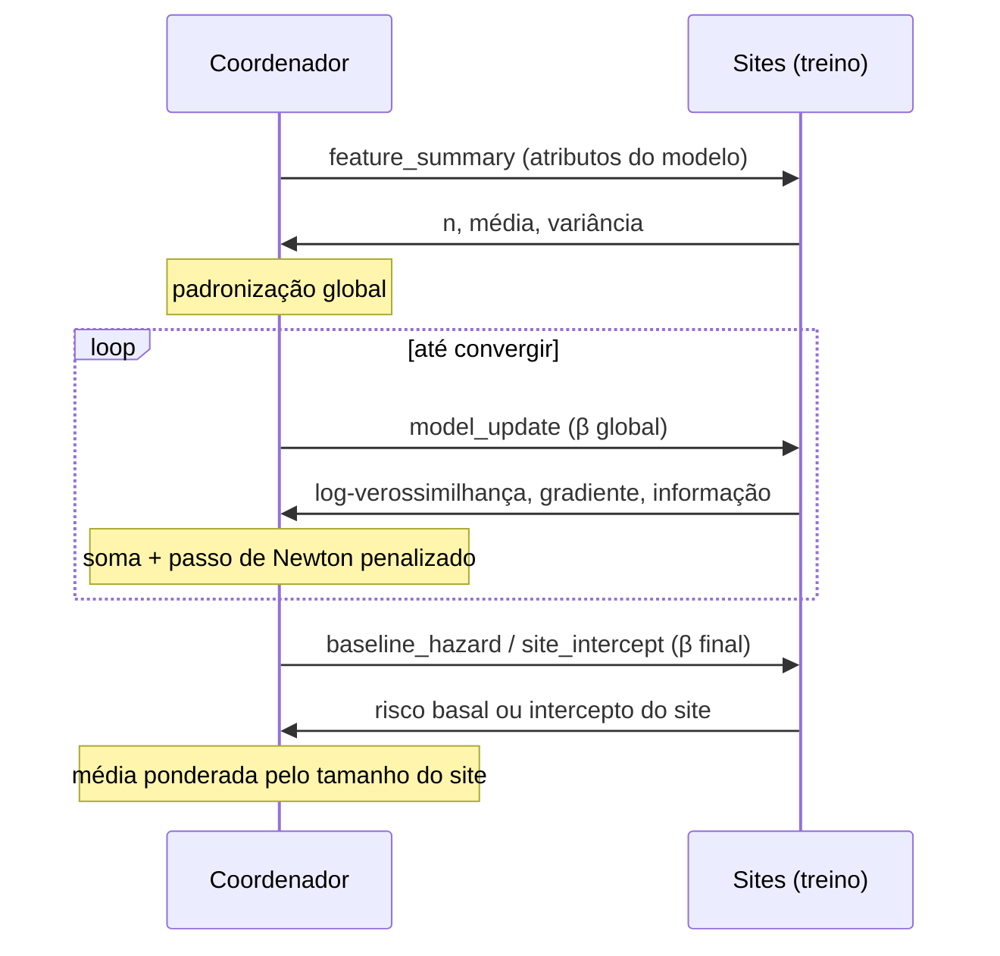

# Etapa 5 — Modelagem prognóstica

Estado: **implementada, aguardando revisão**. Avaliação (C dependente do
tempo, AUROC, Brier com IPCW, calibração, utilidade de decisão), harmonização
e modelos de referência clínicos ficam para a Etapa 6.

> Verificada contra bibliotecas de referência, contra o cálculo centralizado
> equivalente e com sites sintéticos de estrutura plantada. **Nada foi
> executado sobre dados reais**; os hiperparâmetros da configuração de exemplo
> são exemplos.

## 1. O que a etapa entrega

| Módulo | Função |
|---|---|
| `client/models/cox.py` | Verossimilhança parcial de Cox (Breslow, estratos), risco basal de Breslow, ajuste local |
| `client/models/logistic.py` | Kaplan–Meier da censura, rótulos e pesos por horizonte, logística ponderada, intercepto perfilado por site |
| `client/models/forest.py` | Floresta de sobrevivência (scikit-survival) atrás da mesma interface; só local |
| `client/models/prediction.py` | Probabilidade de conversão em cada horizonte a partir de um modelo liberado |
| `client/models/local.py`, `__main__.py` | Treinamento local por CLI: modelos e predições gravados no site |
| `client/splits.py` | Partição treino/teste determinística por site |
| `shared/newton.py` | Newton–Raphson penalizado, alimentado por avaliações externas (locais ou somadas entre sites) |
| `shared/training.py`, `shared/models.py` | Configuração dos modelos e formato do modelo liberado |
| `coordinator/training/protocol.py` | Rodadas do treinamento federado |
| `backend/` | Tabela `models` com o modelo liberado; rotas `/models` e `/models/{id}` |

Cada observação tem tempo de seguimento, indicador de evento (censura à
direita quando falso) e atributos. As probabilidades são estimadas em 12, 24 e
36 meses (horizontes obrigatórios na configuração).

## 2. Separação entre treino e avaliação

Com `data_split` na configuração, **cada site separa localmente** uma
partição de teste:

- estratificada pelo indicador de evento;
- definida pelo SHA-256 de `semente|participante`, logo independente da ordem
  das linhas.

A seleção federada (Etapa 4) e todo o treinamento usam **só a partição de
treino**. O teste reservado à Etapa 6 nunca influencia nada: um teste
substitui os dados dos participantes reservados por ruído, e a seleção e os
modelos saem idênticos.

## 3. Modelos

### Cox (referência)

- Riscos proporcionais, efeito log-linear dos atributos padronizados, empates
  por Breslow, penalidade ridge opcional.
- Probabilidade de conversão: 1 − exp(−H0(τ)·exp(xβ)).
- **O risco basal não é extrapolado**: num horizonte após o último seguimento
  ele fica indefinido (NaN), em vez de repetir o último valor.

### Logística por horizonte (comparador)

Para cada horizonte τ, cada participante tem um de três status:

| Situação | Status |
|---|---|
| evento observado em T ≤ τ | convertido |
| seguido além de τ (T > τ) | não convertido conhecido |
| censurado em T ≤ τ | **status desconhecido; nunca vira não conversor** |

Duas formas de lidar com os desconhecidos:

- **`ipcw`**: peso 1/G(T−) para convertidos e 1/G(τ) para não convertidos
  conhecidos, com G a curva de Kaplan–Meier da censura do próprio site.
  Com só o intercepto, reproduz **exatamente** a incidência acumulada de
  Kaplan–Meier, inclusive com tempos empatados (testado).
- **`complete_case`**: descarta os desconhecidos. É enviesada; fica só como
  referência.

O intercepto pode ser:

- **`common`**: um intercepto para todos os sites;
- **`site_specific`**: um intercepto por site, análogo ao Cox estratificado.

### Outros modelos

A interface `SurvivalModel` admite outros modelos. A floresta de sobrevivência
é o exemplo incluído; ela não tem protocolo federado e só roda localmente.

## 4. Treinamento federado

Nenhum modelo é treinado por média de parâmetros (FedAvg). Cada iteração de
Newton é uma soma exata das contribuições dos sites:



O que é exato e o que é aproximação:

| Modelo | Resultado federado |
|---|---|
| Cox | **idêntico** ao Cox centralizado estratificado por site: coeficientes comuns, risco basal próprio por site |
| Logística, intercepto comum | **idêntica** à logística centralizada ponderada, com os pesos de censura de cada site |
| Logística, intercepto por site | cada site maximiza o próprio intercepto localmente (verossimilhança perfilada) e envia gradiente e informação já com o intercepto eliminado (complemento de Schur); **idêntica** ao ajuste centralizado com um intercepto por site |
| Risco basal (Cox) e intercepto liberados | **aproximação**: média dos valores dos sites ponderada pelo tamanho; ver seção 7 |

Regras do protocolo:

- **Conjunto de sites fixo por modelo.** As rodadas de Newton e a rodada final
  de um modelo precisam ter exatamente os mesmos sites. Se um site sai no
  meio, aquele modelo falha, em vez de misturar funções objetivo (bug
  encontrado e corrigido nesta etapa). Os modelos seguintes começam com os
  sites restantes.
- **Divulgação**: cada site recusa contribuir com menos de `min_events`
  eventos. Na logística, também com menos de `min_events` não conversores
  conhecidos, ou com coorte efetiva abaixo de `min_cohort_size`.
- **Falha isolada**: um modelo que falha (por exemplo, a estratégia de
  seleção não escolheu nenhum atributo) é registrado com o motivo, e os demais
  continuam.

## 5. O que é liberado

O **modelo liberado** (`shared/models.py`) contém:

- atributos, centro e escala da padronização;
- coeficientes e erros-padrão;
- risco basal ou intercepto combinados;
- diagnóstico do ajuste: convergência, iterações, rodadas e histórico da
  verossimilhança penalizada.

Os agregados das rodadas guardam o β avaliado em cada iteração e a
log-verossimilhança total.

**Não são liberados** o gradiente, a informação, o risco basal e o intercepto
de cada site. Os testes varrem o resultado, o banco e o que os clientes
recebem; uma mutação que libera o risco basal de um site é detectada. Os
clientes recebem apenas parâmetros globais.

## 6. Achado nos dados sintéticos: confusão por site

Nos sites sintéticos, as médias dos atributos diferem entre sites (como
diferenças de equipamento), mas o risco não. Com **intercepto comum**, a
logística atribui a `feat_moderate` coeficiente **negativo**, embora o efeito
plantado seja positivo em todos os sites. O ajuste centralizado equivalente dá
o mesmo resultado, então não é erro de implementação: é confusão por site.

O Cox estratificado e a logística com intercepto por site recuperam o sinal
correto. Isso antecipa a Etapa 6: modelos não estratificados precisam de
harmonização, ou de termos por site, antes de serem comparados.

## 7. Hipóteses e limitações

- **Risco basal liberado**: média ponderada dos riscos basais de Breslow dos
  sites. Não é o estimador de Breslow da população combinada; serve para
  aplicar o modelo fora dos sites de treino. Para um site participante,
  usar o próprio risco basal (Etapa 6) é mais bem calibrado.
- Um horizonte sem participantes em risco em **algum** site fica indefinido no
  modelo liberado, em vez de usar só os sites que o alcançam.
- **Divulgação ao coordenador**: ele vê, por site, gradiente e informação a
  cada iteração, o risco basal nos horizontes e o intercepto por site. Muitas
  iterações com poucos participantes por atributo aumentam o risco de
  reconstrução. Agregação segura não foi implementada.
- **Pressupostos do Cox** (riscos proporcionais, linearidade) não são testados
  aqui.
- Os horizontes da logística são ajustados separadamente; as probabilidades
  podem não crescer com o horizonte.
- O IPCW supõe censura independente dos atributos e da conversão; pesos
  grandes (G perto de 0) tornam o ajuste instável.
- A partição estratifica pelo evento, mas não por site × tempo de
  seguimento.
- Não há modelo centralizado: ele só faria sentido com autorização para juntar
  dados. As comparações de equivalência acima foram feitas nos testes, sobre
  dados sintéticos.

## 8. Exemplo e custos

`experiments/configs/stage5_federated_models.yaml` acrescenta à Etapa 4 uma
partição de teste de 30% e seis modelos:

| Modelo | Atributos |
|---|---|
| `cox_selected` | estratégia `sequential_stratified` |
| `cox_relevance_only` | estratégia `relevance_only` |
| `cox_reference` | lista explícita |
| `logistic_ipcw_site` | `sequential_stratified`, IPCW, intercepto por site |
| `logistic_ipcw_common` | `sequential_stratified`, IPCW, intercepto comum |
| `logistic_complete_case_site` | `sequential_stratified`, casos completos, intercepto por site |

Custos medidos:

- 77 rodadas e cerca de 318 KB trafegados no total (seleção + treinamento);
- cada Cox converge em 4–5 rodadas de Newton, e cada horizonte logístico em
  5–6;
- o tempo de treinamento é registrado como `training_time`.

Treinamento local por site (CLI), para comparação na Etapa 6:

```bash
uv run python -m client.models --features var/sites/client-01/features.csv --manifest site/manifest.csv --data-origin real --config experiments/configs/models/local_v1.yaml --selection-csv var/sites/client-01/selection/selected_features.csv --selector reliable_relevant_nonredundant --output-dir var/sites/client-01/models
```

## 9. Decisões que pedem revisão

1. **Risco basal e intercepto liberados** como média ponderada dos sites.
   Alternativa: liberar só os coeficientes e exigir que cada site use o
   próprio risco basal; o modelo deixaria de ser aplicável a um site novo sem
   recalibração.
2. **Intercepto da logística**: o exemplo traz as duas formas para comparar.
   Recomendo `site_specific` como padrão das comparações.
3. **Tamanho da partição de teste** (30%) e a semente. Alternativa:
   validação externa deixando um site inteiro de fora, em vez de partição
   interna.
4. **Ridge**: valor fixo na configuração. Escolher por validação cruzada
   federada custaria muitas rodadas a mais.
5. **Divulgação por iteração** ao coordenador (seção 7).
