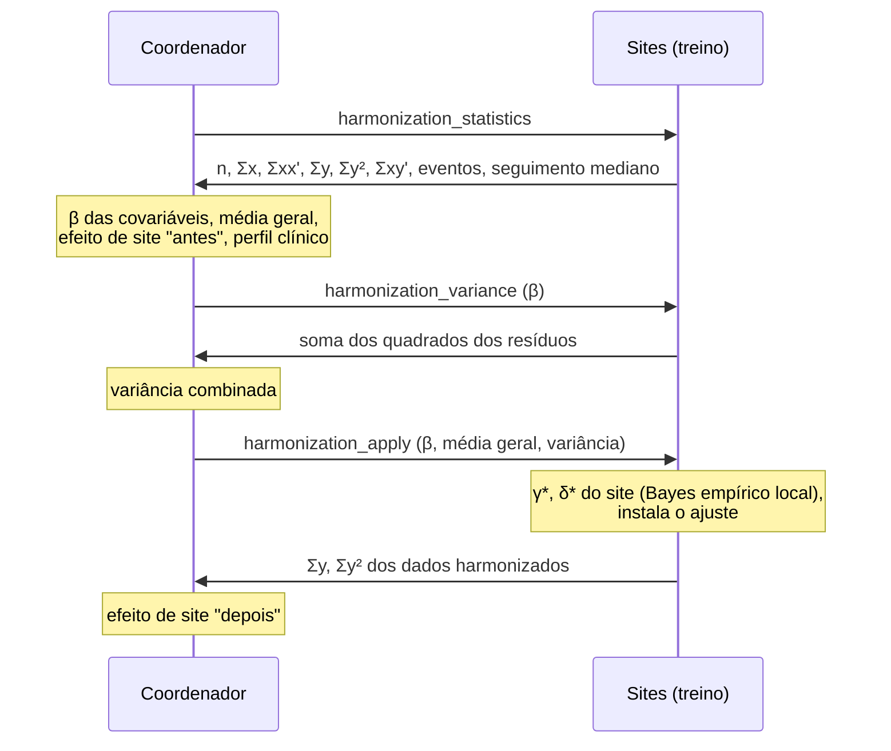

# Etapa 6 — Avaliação e harmonização

Estado: **implementada, aguardando revisão**. Backend consolidado, dashboard e
exportação de relatórios ficam para a Etapa 7.

> Verificada contra bibliotecas de referência (scikit-survival, neuroCombat),
> contra o cálculo centralizado equivalente e com sites sintéticos de
> estrutura plantada. **Nada foi executado sobre dados reais**; as métricas
> mostradas aqui não são resultados científicos.

## 1. O que a etapa entrega

| Módulo | Função |
|---|---|
| `evaluation/censoring.py` | Convenções de censura comuns a modelos e métricas |
| `evaluation/metrics.py` | Métricas a partir de somas aditivas: AUC, C, Brier, calibração, curva de decisão |
| `harmonization/combat.py` | ComBat (Bayes empírico paramétrico), centralizado e decomposto para uso federado |
| `harmonization/assessment.py` | Tamanho dos efeitos de site e diferenças clínicas entre sites |
| `client/harmonize.py` | Ajuste ComBat do próprio site, guardado e aplicado localmente |
| `coordinator/harmonization/protocol.py` | Rodadas do ComBat federado (d-ComBat) e avaliação dos efeitos de site |
| `coordinator/evaluation/protocol.py` | Avaliação distribuída por modelo e variante |
| `experiments/centralized.py` | Referência centralizada, só com autorização explícita |
| `backend/` | Tabelas `harmonizations` e `evaluations`; rotas `/results/{id}/harmonization` e `/results/{id}/evaluation` |

Ordem do pipeline completo: rodadas fixas → **harmonização** → seleção
federada → treinamento federado → **avaliação** (interna e externa).

## 2. Métricas

Todas consideram tempo e censura, e são calculadas a partir de **somas
aditivas**. Um site calcula as suas; o agregado é a soma.

| Métrica | Definição | Conferida contra |
|---|---|---|
| AUC no horizonte τ (12, 24, 36 meses) | cumulativa/dinâmica com IPCW (Uno; Hung & Chiang) | `cumulative_dynamic_auc`, até 1e-12 |
| Concordância dependente do tempo | C de Uno truncado em τ | `concordance_index_ipcw`, até 1e-12 |
| Brier com IPCW | Graf et al.; e Brier escalado (IPA) | `brier_score`, até 1e-12 |
| Calibração | observado (IPCW) × previsto por faixa de risco; O/E; erro médio de calibração | modelo bem especificado: O/E ≈ 1 |
| Utilidade de decisão | benefício líquido do modelo, de tratar todos e de não tratar (Vickers) | cálculo direto |

### Como se agrega entre sites

- **Discriminação (AUC, C)**: conta só pares de participantes **do mesmo
  site** (métrica estratificada por site). Comparar participantes de sites
  diferentes exigiria que predições individuais saíssem dos sites.
- **Brier, calibração e benefício líquido**: agregam exatamente.
- **Pesos de censura**: cada site usa a curva de Kaplan–Meier da própria
  censura, estimada no conjunto avaliado.

### Controle de divulgação

As faixas de calibração com menos de `min_cohort_size` participantes são
fundidas no próprio site antes do envio. O agregado usa as bordas comuns a
todos os sites. Um teste de propriedade com milhares de casos aleatórios
garante que nenhuma faixa pequena e não vazia sai do site; ele detectou e
levou à correção de um defeito na fusão da última faixa.

Limitação: **não há intervalos de confiança**. Eles exigem reamostragem de
indivíduos, que teria de ser local e combinada entre sites.

## 3. Avaliação distribuída

Uma rodada `model_evaluation` por (modelo, variante). Os sites devolvem só as
somas da seção 2.

| Variante | O que é avaliado |
|---|---|
| `released` | modelo federado como liberado (risco basal ou intercepto combinados) |
| `site_baseline` | mesmos coeficientes, risco basal (Cox) ou intercepto (logística por site) **do próprio site**, estimado na sua partição de treino; é uma recalibração local |
| `local` | modelo de cada site, mesma configuração e atributos, treinado só com os dados do site |

Escopos:

| Escopo | Como funciona |
|---|---|
| `internal` | partição de teste de cada site, nunca usada na seleção nem no treinamento |
| `external:<site>` | **validação externa deixando um site de fora**: seleção e treinamento refeitos sem o site, avaliação em todos os participantes dele |

Os **modelos de referência** clínicos, demográficos ou volumétricos entram
como modelos com lista explícita de atributos. No exemplo:
`cox_clinical_reference` usa só `clin_age`, e `cox_reference` usa atributos
fixos.

Métricas por site só são liberadas com `release_site_metrics: true`; a
validação externa exige essa opção, porque avalia um site de cada vez.

## 4. Harmonização

### ComBat

Modelo: y = α + x'β + γ_site + δ_site·ε, com ajuste empírico de Bayes
paramétrico. As covariáveis biológicas x (por exemplo, idade) são
preservadas; **o desfecho nunca é covariável**.

A implementação concorda com o neuroCombat até a precisão `float32`, que é a
precisão em que o neuroCombat calcula internamente; a minha é estável em
~1e-14.

### ComBat federado (d-ComBat)

As prioris de Bayes empírico são estimadas **dentro de cada site, entre
atributos**. Por isso só a regressão e a variância combinada precisam de
comunicação:



- O resultado é **idêntico** ao ComBat centralizado sobre as partições de
  treino reunidas (~1e-10).
- Os ajustes γ* e δ* de cada site **não saem do site** (testado).
- Os parâmetros são estimados **só na partição de treino** e aplicados
  depois, sem mudança, aos participantes reservados; alterar os reservados
  não muda nenhum ajuste (testado).

### Avaliação dos efeitos de site

Também roda com `method: none`, isto é, avaliação sem correção:

- **efeito de site por atributo**: η² e F da ANOVA de um fator, antes e depois
  da harmonização;
- **diferenças clínicas entre sites**: η² de cada covariável por site,
  qui-quadrado da taxa de conversão e faixa do seguimento mediano (Kaplan–Meier
  reverso);
- **perfil por site** (n, taxa de eventos, seguimento mediano), só com
  `release_site_summaries: true`.

**Nem toda diferença entre sites é técnica.** O ComBat remove tudo que difere
entre sites e não é covariável listada, inclusive diferenças clínicas reais.
O relatório mostra quanto os sites diferem em covariáveis, eventos e
seguimento, para que essa decisão seja tomada com dados.

## 5. Referência centralizada

`experiments/centralized.py` (ou a opção `--centralized-reference
"<autorização>"` da CLI de simulação) reúne os dados individuais dos sites
simulados. Por isso:

- **exige um texto de autorização**, que é gravado com o resultado (sem ele, a
  execução é recusada);
- só funciona em simulação.

Calcula:

- o modelo centralizado sem estratos;
- a avaliação desse modelo e do modelo federado, com e sem estratificação por
  site.

A avaliação estratificada do modelo federado coincide com a avaliação
distribuída até 1e-10 (testado). Isso valida ao mesmo tempo a avaliação
federada e o ComBat federado, porque os dados harmonizados entram nas duas.

## 6. Exemplo (dados sintéticos)

`experiments/configs/stage6_harmonization_evaluation.yaml` parte da Etapa 5 e
acrescenta:

- **efeitos técnicos de site**: deslocamento e escala 1,0 / 1,8 / 0,6;
- **covariável clínica `clin_age`**, que difere de verdade entre os sites e
  aumenta o risco.

Resultados verificados (mecânica, não ciência):

| Verificação | Resultado |
|---|---|
| η² mediano dos atributos de imagem | 0,29 antes → 0,0001 depois |
| η² de `clin_age` por site | 0,11, preservado (não é harmonizado) |
| AUC e C entre `released` e `site_baseline` | iguais: mesmos coeficientes, mesma ordenação dentro do site; Brier e O/E mudam |
| Validação externa sem `client-01` | `feat_mixed` (efeito invertido nesse site) parece concordante nos outros dois, é selecionado e o modelo cai para AUC ≈ 0,49; o modelo com atributos fixos mantém ≈ 0,74 |
| Custo | 233 rodadas, ~870 KB (a validação externa refaz seleção e treinamento três vezes) |

O caso da validação externa é a armadilha plantada; mostra por que ela é
necessária.

## 7. Hipóteses e limitações

- **Discriminação agregada é estratificada por site**: não é a AUC da
  população combinada quando os sites diferem em risco. A referência
  centralizada autorizada calcula as duas.
- **Sem intervalos de confiança.**
- O IPCW supõe censura independente dos atributos, estimada no conjunto
  avaliado; conjuntos pequenos dão pesos instáveis.
- Calibração com faixas fixas; a fusão de faixas reduz a resolução em sites
  pequenos.
- ComBat: efeitos de site aditivos e multiplicativos por atributo; só Bayes
  empírico paramétrico (sem versão não paramétrica, lote de referência ou
  versão longitudinal).
- A confiabilidade da Etapa 3 foi estimada nos dados brutos. O ICC é
  invariante a transformações afins dentro do site, como as do ComBat, desde
  que as medidas repetidas recebam o mesmo ajuste.
- **Validação externa**: a harmonização não é refeita em cada repetição
  deixando um site de fora. Ela não usa o desfecho, mas o site retirado
  contribuiu para β, média geral e variância combinada (leve otimismo).
  Seleção e treinamento são refeitos.
- **Divulgação**: o coordenador vê, por site, as somas da regressão do
  ComBat e as somas de avaliação. São liberadas por site apenas métricas de
  desempenho e o perfil clínico, e só quando configurado.
- A taxa de eventos por site é uma comparação bruta, que ignora seguimento e
  censura.

## 8. Como executar

```bash
uv sync --extra backend --extra dev --extra imaging --extra science
```

```bash
uv run python -m experiments.run_simulation --config experiments/configs/stage6_harmonization_evaluation.yaml
```

```bash
uv run python -m experiments.run_simulation --config experiments/configs/stage6_harmonization_evaluation.yaml --centralized-reference "texto da autorização"
```

## 9. Decisões que pedem revisão

1. **Discriminação estratificada por site** como métrica federada principal.
   Uma AUC da população combinada exigiria agregação segura de predições.
2. **Liberar métricas por site.** O exemplo libera; elas permitem comparar
   coortes, mas expõem o desempenho de cada instituição.
3. **ComBat antes da seleção**, com `clin_age` como covariável. Outras
   covariáveis (sexo, escolaridade, APOE) entrariam aqui; o desfecho nunca.
4. **Validação externa sem refazer a harmonização** em cada repetição.
5. **Intervalos de confiança**: proponho bootstrap local por site, combinado
   entre sites, como próximo passo de avaliação.
6. **Pesos de censura do conjunto avaliado.** Alternativa: estimá-los na
   partição de treino.
