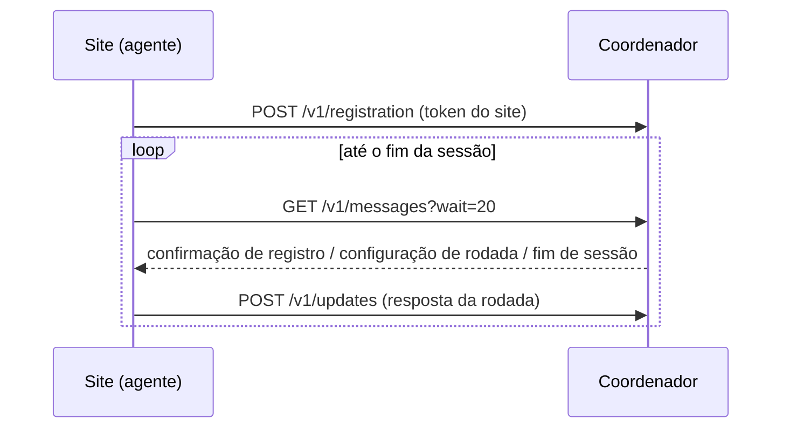

# Etapa 8 — Consolidação

Estado: **implementada, aguardando revisão**. A visão geral da arquitetura
está em [README.md](README.md); os custos, em [custos.md](custos.md).

> Verificada com dados sintéticos, inclusive numa implantação distribuída em
> contêineres. Nenhuma análise com dados reais foi feita.

## 1. O que a etapa entrega

| Item | Conteúdo |
|---|---|
| Arquitetura documentada | [README.md](README.md): componentes, fluxo, protocolo, modelo de privacidade, modos de execução, registro de decisões |
| Implantação distribuída | transporte HTTP com sites conectando para fora; tokens por site; agente do site; coordenador distribuído; lançador `distributed`; demonstração em Docker |
| Experimentos reprodutíveis | impressão digital dos resultados liberados, proveniência do código (migração `0002`), `python -m experiments.reproduce` |
| Custos | `python -m experiments.benchmark_costs` e o relatório gerado [custos.md](custos.md) |
| Integração contínua | `.github/workflows/ci.yml`: testes do backend, checagens do dashboard, construção das imagens |

## 2. Implantação distribuída

### Modelo de comunicação

Os sites **só fazem conexões de saída**: registram-se no coordenador e
consultam mensagens com espera longa (*long polling*). Nenhuma instituição
precisa abrir portas no firewall. O coordenador não conhece o endereço dos
sites.

As mensagens são exatamente as da simulação (`shared.protocol`, versão `1.4`).
A guarda de saída do site e a validação de entrada do coordenador valem sem
mudança.

### Segurança

| Regra | Como |
|---|---|
| Cada site se autentica | token próprio; o coordenador guarda só o SHA-256 (`sites.yaml`) |
| Um site só age como ele mesmo | o token determina o site; registrar ou responder em nome de outro → 403 |
| Sem respostas fora de hora | resposta não solicitada, atrasada ou repetida → 409, e não é usada |
| Tamanho máximo | 1 MiB por mensagem → 413 |
| Site que não responde | a rodada segue sem ele após o prazo; aparece como `no_response` |
| Site consente com um experimento | o site declara o único experimento que atende; outros são recusados no registro |
| Transporte | TLS obrigatório entre instituições, por proxy reverso ou `--ssl-certfile/--ssl-keyfile` |

### Guia de implantação

**Equipe do coordenador:**
1. Criar o experimento (dashboard ou `POST /experiments`), com configuração
   **sem** a seção `simulation`.
2. Para cada site: `python -m coordinator.network.tokens client-0X`. Entregar o
   token ao site por canal seguro e acrescentar a linha de hash ao
   `sites.yaml`.
3. Publicar o endpoint com TLS (porta 8700 por padrão, atrás de um proxy
   reverso).
4. Executar com `FEDRAD_LAUNCHER=distributed` e `FEDRAD_SITES_FILE`
   (backend), ou com `python -m experiments.run_distributed --experiment-id ...
   --sites sites.yaml`.

**Cada instituição:**
1. Extrair atributos localmente (Etapa 2) e, se houver, rodar o estudo de
   confiabilidade (Etapa 3).
2. Preparar o manifesto com tempo de seguimento e evento.
3. Escrever o `site.yaml` local (modelo em `client/site_config.py`):
   identificador, experimento, endereço do coordenador, arquivo do token,
   caminhos dos dados.
4. Rodar `python -m client.agent --site-config site.yaml`, ou o contêiner, com
   saída HTTPS liberada para o coordenador.
5. Só saem do site as mensagens da tabela de protocolo
   ([README.md](README.md#4-protocolo-versão-14)).

### Demonstração em Docker

`infrastructure/distributed/demo.sh` sobe banco, MLflow, backend (com
lançador distribuído) e dashboard, cria o experimento e inicia três contêineres
de site. Cada site entra só numa rede `federation`.

Verificado nesta sessão:
- os três sites registraram, serviram 69 rodadas e saíram com código 0 ao fim
  da sessão;
- os resultados apareceram no dashboard;
- de dentro da rede dos sites, banco e MLflow nem resolvem por nome.

## 3. Reprodutibilidade

- **Impressão digital** (`coordinator/provenance.py`): SHA-256 do JSON canônico
  de tudo que o experimento liberou (agregados das rodadas, harmonização,
  seleção, modelos, avaliação, sites participantes), **sem** tempos, bytes nem
  memória.
- **Proveniência do código**: commit do git (e se havia alterações locais),
  SHA-256 do `uv.lock`, versões do Python e das bibliotecas.
- Ambas são gravadas em cada experimento (colunas novas, migração `0002`, que
  preserva os dados existentes) e como tags no MLflow.

`python -m experiments.reproduce --config <arquivo>` roda duas vezes e exige
impressões idênticas. `--experiment-id <id>` reexecuta um experimento gravado
e compara; se diferir, lista o que mudou no código.

Verificado por teste:
- duas execuções têm tempos diferentes e a mesma impressão digital;
- outra semente dá outra impressão;
- **a execução distribuída por HTTP tem a mesma impressão da simulação**.

## 4. Custos

Ver [custos.md](custos.md). Em resumo:
- o pipeline completo usa ~39 rodadas, quase independentes do tamanho do
  problema;
- o tráfego é linear no número de sites e da ordem de centenas de KB;
- a maior mensagem tem poucos KB;
- o transporte HTTP acrescenta ~25 ms por rodada na rede local.

Entre instituições, o custo dominante será a latência: rodadas × tempo de ida e
volta.

## 5. Integração contínua

`.github/workflows/ci.yml`, em todo pull request e na `master`:

| Job | O que faz |
|---|---|
| `backend` | `uv sync --frozen`, `ruff` e `pytest tests/federated` |
| `frontend` | `npm ci`, checagem de tipos, testes e build |
| `images` | constrói as três imagens e valida os dois arquivos Compose |

Os testes do pipeline OASIS-3 legado precisam do seu próprio ambiente fixado e
não fazem parte do fluxo.

## 6. Problemas encontrados nesta etapa

1. **Privacidade — seguimento mediano.** O seguimento mediano por site (Etapa
   6) é uma estatística de ordem: era o tempo de seguimento exato de um
   participante. Um teste novo, que varre todas as mensagens e não só as de
   avaliação, detectou o problema. Agora o valor sai arredondado para meses
   inteiros, o contrato rejeita valores não arredondados e há teste específico.
2. **Compose em camadas.** Caminhos relativos no arquivo de sobreposição são
   resolvidos a partir do primeiro arquivo. O `sites.yaml` não era encontrado,
   e o Docker criava um diretório vazio no lugar. Corrigido.
3. **Imagem sem o pacote do agente.** A imagem não incluía o `httpx` do agente.
   Corrigido com o grupo de dependências `site`.
4. **Atributo complexo (visto só no CI).** Na máquina do GitHub Actions, o
   PyRadiomics devolveu um valor complexo num atributo de forma
   (decomposição em autovalores). A conversão para real descartava a parte
   imaginária em silêncio. Agora uma parte imaginária desprezível (ruído
   numérico) é descartada, e uma relevante faz o caso falhar com
   `complex_feature`; há teste.

## 7. Hipóteses e limitações

- A impressão digital é garantida no mesmo ambiente (mesmas versões e mesma
  plataforma). Entre CPUs ou bibliotecas de álgebra linear diferentes, o
  arredondamento pode mudar dígitos finais e, portanto, a impressão; o achado 4
  é um exemplo dessa dependência de plataforma.
- O coordenador guarda o estado de um experimento em memória: se o processo
  parar, o experimento precisa ser reiniciado (não há retomada).
- As rodadas são síncronas: o prazo por rodada (`--round-timeout`) limita
  quanto um site lento atrasa todos.
- O token de site é um segredo compartilhado; não há certificados de cliente
  (mTLS) nem rotação automática.
- O estudo de custos mede uma máquina; não inclui latência real entre
  instituições.

## 8. Decisões que pedem revisão

1. **Sites conectando para fora, por espera longa**, em vez de o coordenador
   chamar os sites ou de usar Flower. Simplifica firewalls institucionais; o
   custo é a latência da consulta.
2. **Token por site**, em vez de certificados de cliente. mTLS pode ser
   acrescentado no proxy reverso sem mudar o código.
3. **Consentimento explícito por experimento** no `site.yaml`.
4. **Seguimento mediano em meses inteiros.** Se a precisão de um mês for alta
   demais para coortes pequenas, pode ser arredondado para trimestres.
5. **Integração contínua sem os testes legados do OASIS-3.**
